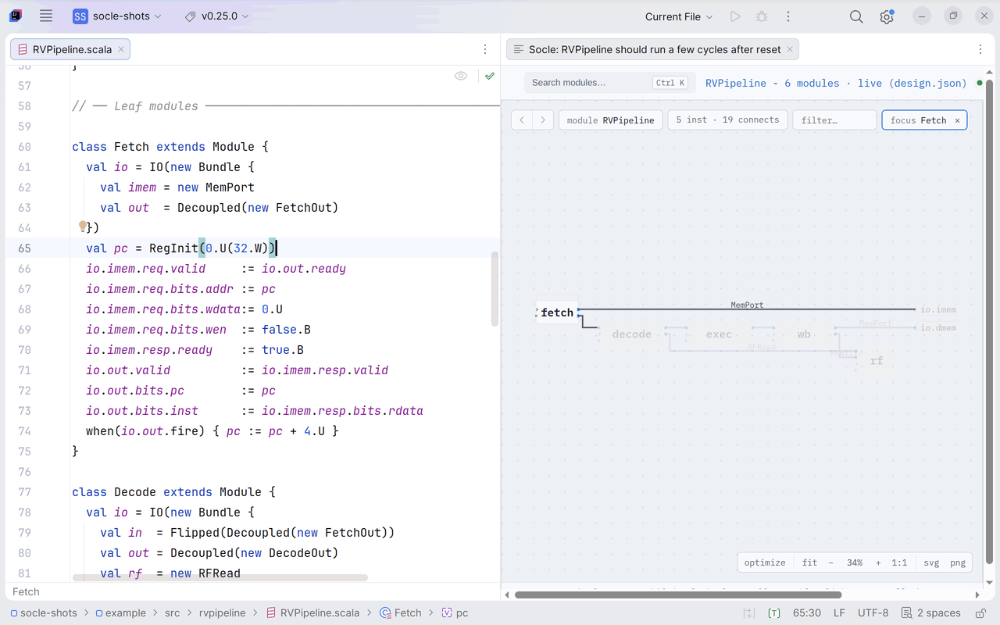
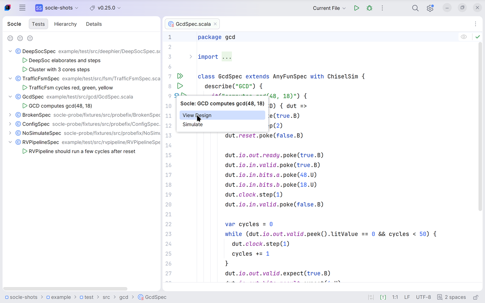
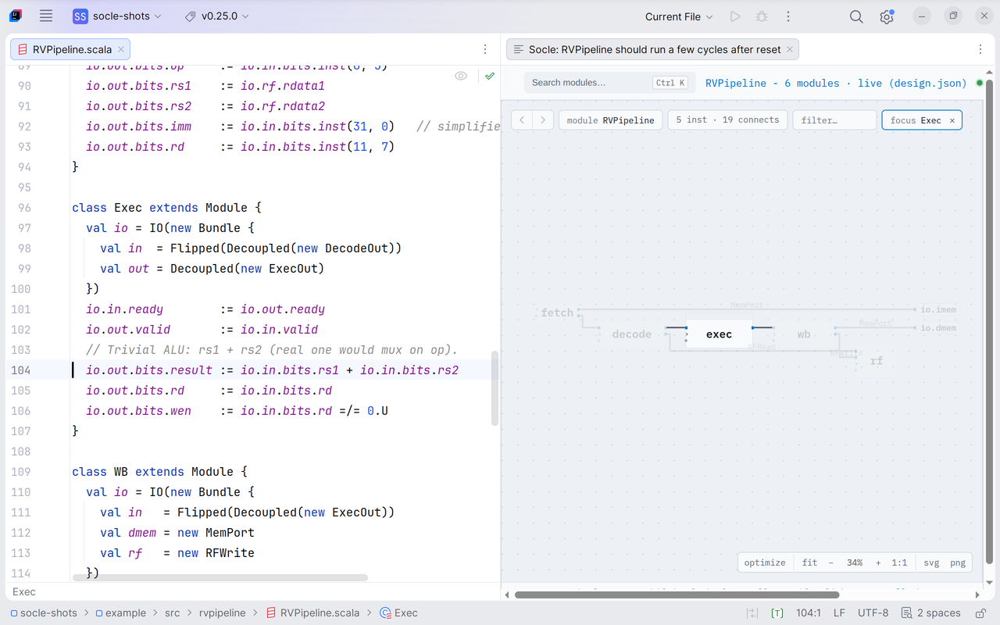
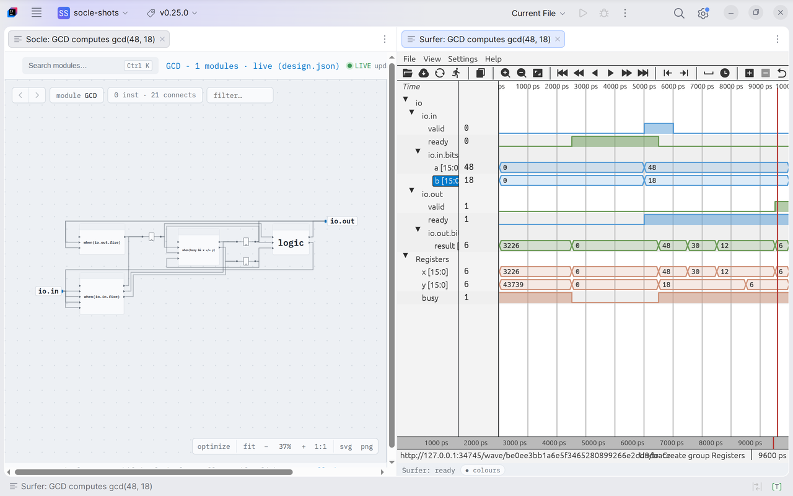
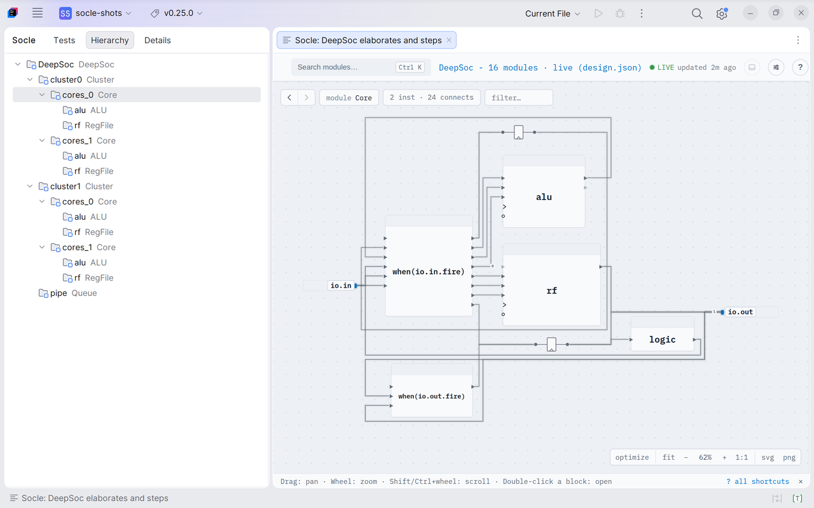

# Socle for IntelliJ IDEA

Chisel IDE support for Scala files: a Socle icon in the margin of each ChiselSim test offers
**View design**, which opens the elaborated design in a panel beside the editor, and **Simulate**.
The schematic follows your cursor, and a click on a box opens its code. The Socle tool window lists
the project's tests (View design and Simulate on each), the design's instance hierarchy, its
classes and the details of the selection.

It is the IntelliJ counterpart of [Socle for VS Code](https://github.com/socless/socle-vscode): the
same features, through the same Socle language server.

<picture>
  <source media="(prefers-color-scheme: dark)" srcset="docs/images/01-cursor-follow-dark.gif">
  
</picture>

## Requirements

- IntelliJ IDEA 2026.2 or newer (the open-source edition is enough), with the JetBrains
  [Scala plugin](https://plugins.jetbrains.com/plugin/1347-scala) and Red Hat's
  [LSP4IJ](https://plugins.jetbrains.com/plugin/23257-lsp4ij).
- Java 21 or newer (set the Java path in Settings | Tools | Socle if `java` on your PATH is older).
- A Mill project that contains the Chisel design, with ChiselSim tests.
- A trusted project: Socle runs your build (Mill) and tests.

## Install

In IntelliJ: Settings | Plugins | Marketplace, search for **Socle (Chisel)** and install it (the IDE
offers LSP4IJ with it). Or download `socle-intellij-<version>.zip` from the
[releases page](https://github.com/socless/socle-intellij/releases) and use Settings | Plugins | the
gear icon | Install Plugin from Disk. Each release bundles the language server of one Socle release
(named in its notes). To build it yourself, see
[DEVELOPING.md](DEVELOPING.md).

## Use it

1. Open a ChiselSim test, for example `example/test/src/gcd/GcdSpec.scala` of a Socle checkout.
   LSP4IJ starts the Socle language server; once it has listed the project's tests, a Socle icon
   appears in the margin of each test.

   <picture>
     <source media="(prefers-color-scheme: dark)" srcset="docs/images/03-margin-icon-dark.png">
     
   </picture>

2. Click the icon and pick **View design**. The design panel opens beside the editor (the first run
   of a test compiles it with Mill, which takes a while). The schematic follows the class under your
   cursor; a click on a box opens its code.

   <picture>
     <source media="(prefers-color-scheme: dark)" srcset="docs/images/01-cursor-follow-dark.png">
     
   </picture>

3. Pick **Simulate** to run the test with waveforms and open the trace in the wave viewer: the
   Surfer app by default, or Surfer inside the IDE with the `surfer-panel` viewer, whose signals
   follow the schematic's selection.

   <picture>
     <source media="(prefers-color-scheme: dark)" srcset="docs/images/02-waveforms-dark.png">
     
   </picture>

The **Socle** tool window (left) has four tabs:
- **Tests:** the project's ChiselSim suites and tests with their state (shown, running, failed);
  View design and Simulate in the context menu, a double-click opens the test.
- **Hierarchy:** the panel's instance tree; a selection takes the schematic there, Open Source in the
  context menu.
- **Classes:** the design's modules by Scala class (your classes first, then library classes), then
  by the constructor arguments they were built with (same arguments, one row; `?` when some value
  could not be read, so those modules were not compared), then their instances; selecting an
  instance takes the schematic there, as a Hierarchy row does. The class view comes from the
  bundled server (Socle 0.30.0 or later).
- **Details:** what is selected in the schematic: its class, parameters and ports.

<picture>
  <source media="(prefers-color-scheme: dark)" srcset="docs/images/04-tool-window-dark.png">
  
</picture>

**Tools | Socle** has Show Design Panel, Show Waveforms (the last Simulate's trace in the Surfer
tab), Refresh Tests and Settings.

## Settings

Settings | Tools | Socle has the settings of Socle for VS Code (`socle.*` there), with the same
meaning and defaults: the Java path and server jar, the wave flag, the wave viewer (`surfer`,
`surfer-panel` or `custom`), the Surfer and custom viewer commands, how the waveforms follow the
selection, and the schematic's look. Changes reach the running server at once; the Java path and the
server jar take effect when the server restarts (Language Servers view, or reopen the project).

## Differences from VS Code

- A margin icon on each test instead of code lenses.
- A tool window instead of the activity bar views.
- The Surfer tab opens in a split to the right of the active editor (IntelliJ has no "column after
  the panel").
- Without JCEF (an IDE run without it) the design opens in your browser, and the Hierarchy, Classes
  and Details tabs stay empty.

## Third-party software

The bundled language server ships [Surfer](https://surfer-project.org/) v0.7.0, built to
WebAssembly, for the panel's Waveform tab. Surfer is a separate work licensed under the EUPL-1.2;
its licence text and source pointer ship beside it in the server jar
(`surfer/LICENSE-EUPL-1.2.txt`, `surfer/SOURCE.md`).

## License

Copyright (C) 2026 Iban Guinebert. Licensed under the GNU AGPL-3.0-only, like Socle: see the
LICENSE file and Socle's [LICENSING.md](https://github.com/socless/socle/blob/main/LICENSING.md),
which also covers the commercial licence. The bundled language server carries its own notices
(`socle-legal/` in the jar).
